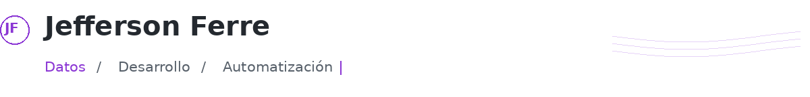
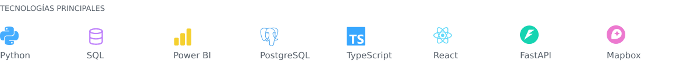
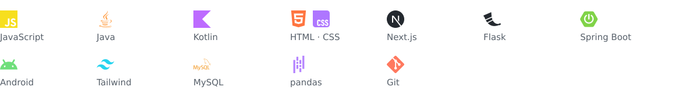
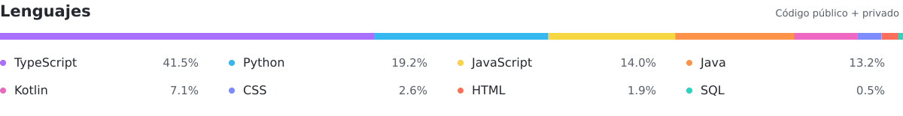
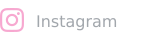

<picture>
  <source media="(prefers-color-scheme: dark) and (prefers-reduced-motion: reduce)" srcset="./assets/intro-dark.png" />
  <source media="(prefers-reduced-motion: reduce)" srcset="./assets/intro-light.png" />
  <source media="(prefers-color-scheme: dark)" srcset="./assets/intro-dark.gif" />
  
</picture>

 

<picture>
  <source media="(prefers-color-scheme: dark) and (prefers-reduced-motion: reduce)" srcset="./assets/stack-dark.png" />
  <source media="(prefers-reduced-motion: reduce)" srcset="./assets/stack-light.png" />
  <source media="(prefers-color-scheme: dark)" srcset="./assets/stack-dark.gif" />
  
</picture>

Ver más tecnologías

<picture>
  <source media="(prefers-color-scheme: dark)" srcset="./assets/extra-dark.svg" />
  
</picture>

 

<a href="./LENGUAJES.md" title="Ver cómo se calcula la distribución de lenguajes">
<picture>
  <source media="(prefers-color-scheme: dark) and (prefers-reduced-motion: reduce)" srcset="./assets/languages-dark.png" />
  <source media="(prefers-reduced-motion: reduce)" srcset="./assets/languages-light.png" />
  <source media="(prefers-color-scheme: dark)" srcset="./assets/languages-dark.gif" />
  
</picture>
</a>

 

#### Redes

<!-- Instagram: envuelve el siguiente picture con <a href="TU_ENLACE_REAL"> ... </a> al disponer de tu URL. -->
<picture>
  <source media="(prefers-color-scheme: dark) and (prefers-reduced-motion: reduce)" srcset="./assets/instagram-dark.png" />
  <source media="(prefers-reduced-motion: reduce)" srcset="./assets/instagram-light.png" />
  <source media="(prefers-color-scheme: dark)" srcset="./assets/instagram-dark.gif" />
  
</picture>
&nbsp;
<!-- LinkedIn: envuelve el siguiente picture con <a href="TU_ENLACE_REAL"> ... </a> al disponer de tu URL. -->
<picture>
  <source media="(prefers-color-scheme: dark) and (prefers-reduced-motion: reduce)" srcset="./assets/linkedin-dark.png" />
  <source media="(prefers-reduced-motion: reduce)" srcset="./assets/linkedin-light.png" />
  <source media="(prefers-color-scheme: dark)" srcset="./assets/linkedin-dark.gif" />
  
</picture>
&nbsp;
<!-- Discord: envuelve el siguiente picture con <a href="TU_ENLACE_REAL"> ... </a> al disponer de tu URL. -->
<picture>
  <source media="(prefers-color-scheme: dark) and (prefers-reduced-motion: reduce)" srcset="./assets/discord-dark.png" />
  <source media="(prefers-reduced-motion: reduce)" srcset="./assets/discord-light.png" />
  <source media="(prefers-color-scheme: dark)" srcset="./assets/discord-dark.gif" />
  
</picture>
&nbsp;
